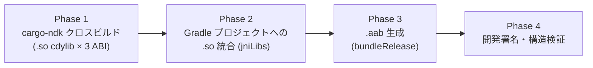

# Android .aab 生成パイプライン構成設計

## 1. 目的・位置づけ

本書は TASK-11.2-S1（Issue #225、親: TASK-11.2 / Issue #224、`docs/spec/05-tasks.md`）の成果物であり、
REQ-11（`docs/spec/04-requirements.md` 147〜156 行）の受け入れ基準「単一コマンドから Android `.aab`
（開発用署名鍵）が生成され、エミュレータへインストール・起動できる」および roadmap M3 の完了基準を
満たすための**構成設計**を確定するものです。

- **本 issue の成果物**: 本書 1 本のみ（コード・スクリプト・Gradle プロジェクトの実体は含まない）。
  実装は後続の sub-issue（下記 6 節）が担当する。
- **iOS 側ミラータスク**: TASK-11.1-S2（Issue #221、PR #469、コミット `ed59938`）が
  `scripts/ios/build-simulator-app.sh` で確立した「ビルド → バンドル組み立て → パッケージ生成 →
  構造検証」の 4 フェーズ構成・環境変数インターフェース（`FANDHE_IOS_*`）を、本書は Android 側へ
  同型で写像する。iOS 側と共通化できる設計判断はそのまま踏襲し、Android 固有の差分（Gradle・
  署名・NativeActivity）のみを新規に設計する。
- **前提となる既存資産**:
  - `scripts/android/versions.env`: JDK 21.0.12+8 / SDK cmdline-tools / NDK 27.3.13750724 /
    `platforms;android-35` / `build-tools;35.0.1` / Gradle 9.6.1 / cargo-ndk 4.1.2 /
    `ANDROID_MIN_API=24` を SSOT 管理（TASK-18.3 完了）。
  - `scripts/android/build-android.sh`: cargo-ndk ラッパー。現状は `fandhe-core`（rlib のみ）を
    3 ABI（arm64-v8a / armeabi-v7a / x86_64）向けにビルドする。ヘッダコメントに「対象パッケージが
    増えた際は本スクリプトの `-p` 指定を拡張する」旨が明記済み。
  - `crates/fandhe-egui-proxy`: `crate-type = ["cdylib", "rlib"]`。`cfg(target_os = "android")`
    分岐で `android-activity`（**NativeActivity 方式**、GameActivity は不採用）+ wgpu
    `Backends::VULKAN` に固定している（TASK-1.5-S2、`src/android.rs` の `android_main`）。
  - `platforms/apple/`: iOS/watchOS/visionOS の Gradle 相当（Xcode プロジェクト）が
    `FandheIosApp` 等の単位で配置済み。Android 側の `platforms/android/` はミラー構成として新設する。
  - `.github/workflows/ci.yml`: `android-env` / `android-build` ジョブが CI runner・
    flock 直列化前提で存在（`ci.md` 準拠）。

## 2. パイプライン全体像（4 フェーズ）

iOS 側（PR #469）の「build → bundle → package → verify」構成を Android 向けに以下のとおり写像する。

### Phase 1: cargo-ndk クロスビルド

- 対象クレート: `fandhe-core`（rlib）ではなく **`fandhe-egui-proxy`**（cdylib）。
- `scripts/android/build-android.sh` の `-p fandhe-core` を `-p fandhe-egui-proxy` へ拡張する
  （ヘッダコメントに明記済みの拡張点。S2 で実施）。既存スクリプトを流用し、新規スクリプトを
  並置しない（後述 3 節「既存 `build-android.sh` との関係」参照）。
- 出力: `cargo ndk -o <jniLibs 相当ディレクトリ>` により ABI 別ディレクトリ
  （`arm64-v8a/` / `armeabi-v7a/` / `x86_64/`）へ `libfandhe_egui_proxy.so` が生成される
  （`[lib] name = "fandhe_egui_proxy"`、`Cargo.toml` 記載どおり）。
- 3 ABI・`--platform "${ANDROID_MIN_API}"`（24）は `build-android.sh` の既存実装をそのまま流用する。

### Phase 2: Gradle プロジェクトへの `.so` 統合

- 配置規約: `app/src/main/jniLibs/<abi>/libfandhe_egui_proxy.so`
  （Gradle/AGP の既定 `jniLibs.srcDirs` 規約に準拠。追加の `sourceSets` 設定を不要にする）。
- Phase 1 の cargo-ndk 出力ディレクトリ構成（ABI 名がそのままディレクトリ名になる）は
  Android の `jniLibs/<abi>/` 命名規約と一致するため、Phase 1 → Phase 2 は単純なディレクトリコピー
  （`cp -R` 相当）で実現できる。中間変換ステップを設けない。

### Phase 3: `.aab` 生成

- `gradle :app:bundleRelease`（AGP の App Bundle タスク）を呼び出す。
- 出力パス規約: `platforms/android/FandheAndroidApp/app/build/outputs/bundle/release/app-release.aab`
  （AGP 既定のパス規約に準拠。カスタム出力パスは設定しない）。

### Phase 4: 開発署名・構造検証

- 署名の挿入ポイントを明示するのみ（実装は S3、Issue #227）。iOS 側 S2 が
  `codesign --sign - --force` の挿入ポイントをコメントで残した前例（`build-simulator-app.sh`
  「フェーズ 2 末尾」参照）に倣い、本書 4 節・S2 実装スクリプトの Phase 3 完了直後・
  構造検証開始前を署名の挿入ポイントとする。
- 構造検証（`.aab` が zip 構造として妥当か、`base/manifest/AndroidManifest.xml` が
  含まれるか等）は S4（Issue #228）のスコープとする。

## 3. CLI インターフェース設計（REQ-11「単一コマンド・終了コードで成否判別」準拠）

- **エントリポイント**: `scripts/android/build-aab.sh`（新設、S2 で実装）。
  `android-env.sh` を source し `versions.env` を SSOT とする既存流儀を踏襲する
  （`build-android.sh` / `verify-android-artifacts.sh` と同一パターン）。
- **既存 `build-android.sh` との関係**: `build-aab.sh` は独立スクリプトとして新設し、
  内部で `build-android.sh` 相当の cargo-ndk 呼び出し（Phase 1）→ Gradle 統合（Phase 2）→
  `.aab` 生成（Phase 3）を一貫して行う。`build-android.sh` を「fandhe-core rlib のみを検証する
  軽量スクリプト」として現状のまま残し、`build-aab.sh` は `fandhe-egui-proxy` 向けの
  cargo-ndk 呼び出しを独自に持つ（`-p` 指定が異なるパッケージ・成果物種別（rlib vs cdylib）を
  対象とするため、共通化すると条件分岐が増え可読性が落ちると判断）。cargo-ndk 呼び出しを
  共通化するかどうかは実装側の裁量とし、本書は「2 つのスクリプトが並存する」
  という責務分界のみを設計として固定する。
- **引数・環境変数**（iOS `FANDHE_IOS_*` と同型のインターフェース設計）:

  | 変数 | 既定値 | 用途 |
  |------|--------|------|
  | `--release` | （既定・唯一対応） | リリースビルド。iOS 側は debug も許容するが、`.aab` は
    ストア提出前提のため本パイプラインは release のみを対象とする（`bundleDebug` は対象外）。 |
  | `FANDHE_ANDROID_APP_SO` | 空 | プリビルト `.so` 注入によるドライラン用。非空の場合は
    Phase 1（cargo-ndk クロスビルド）をスキップし、指定パスの `.so` を各 ABI 分の
    `jniLibs/<abi>/` へそのまま配置する。iOS 側 `FANDHE_IOS_APP_BINARY`
    （Apple SDK リンカが必要な cargo build を実行できない Linux 環境でのスタブ注入）と
    同一目的。ただし Android は Linux 上でも cargo-ndk クロスビルドが完結するため、
    本変数は主に「Gradle 統合以降（Phase 2〜4）のみを単体検証したい」場合に用いる。 |
  | `FANDHE_ANDROID_KEYSTORE` | 空 | 開発署名鍵（`.jks`）のパス。S3 の実装対象（4 節参照）。
    未設定時は署名なしの `.aab` を生成する（Phase 4 をスキップして終了）。 |
  | `FANDHE_ANDROID_KEYSTORE_PASSWORD` | 空 | 開発署名鍵のパスフレーズ。環境変数経由のみで受け取り、
    ログ・エラーメッセージに一切出力しない（security.md 準拠）。 |

- **終了コード規約**: 各フェーズの失敗（cargo-ndk 失敗・Gradle 失敗・`.aab` 未生成）で
  非 0 終了する。`build-android.sh` の `fail()` ヘルパー（`set -euo pipefail` + 明示的な
  前提条件チェック）と同一パターンを踏襲する。

## 4. Gradle プロジェクト構成（S2 で作成）

- **配置**: `platforms/android/FandheAndroidApp/`（`platforms/apple/FandheIosApp/` とのミラー構成。
  `platforms/android/` を新設し、他の Android 派生アプリ（TV・Wear 等、将来スコープ）も
  同ディレクトリ配下に並置できる構成とする）。
- **モジュール構成**: 単一 `app` モジュール・Kotlin DSL（`build.gradle.kts`、`settings.gradle.kts`）。
- **起動方式**: NativeActivity 方式。`AndroidManifest.xml` の `<meta-data
  android:name="android.app.lib_name" android:value="fandhe_egui_proxy"/>`
  （`Cargo.toml` の `[lib] name = "fandhe_egui_proxy"` と一致させる）により OS 標準の
  `NativeActivity` グルーコードから起動する。Java/Kotlin コードは
  `Activity` 宣言（`android:name="android.app.NativeActivity"`）のみで、独自の
  Activity/Service クラスを実装しない（`fandhe-egui-proxy` の `android-native-activity`
  feature（TASK-1.5-S2）が前提とする起動契約と一致させる）。
- **バージョン整合**（`versions.env` SSOT との一致）:

  | 項目 | 値 | 根拠 |
  |------|-----|------|
  | `compileSdk` | 35 | `versions.env` の `PLATFORM_PACKAGE="platforms;android-35"` と一致 |
  | `minSdk` | 24 | `versions.env` の `ANDROID_MIN_API="24"` と一致（cargo-ndk `--platform` と同値） |
  | AGP バージョン | **9.3.0** | Gradle 9.6.1 との互換性を一次情報で確認（下記） |
  | Gradle バージョン | 9.6.1 | `versions.env` の `GRADLE_VERSION` を変更せず流用 |

  - **AGP バージョン選定根拠**（取得日 2026-07-31）: Android Gradle Plugin 公式リリースノート
    <https://developer.android.com/build/releases/agp-9-3-0-release-notes> により、
    AGP 9.3.0 は最小 Gradle バージョン 9.5.0（デフォルトも 9.5.0）を要求することを確認した。
    `versions.env` 固定の Gradle 9.6.1（9.5.0 以上）はこの要件を満たすため、AGP 9.3.0 を
    採用する。AGP 9.3.0 は JDK 17 以上を要求し、`versions.env` 固定の JDK 21.0.12+8 は
    この要件も満たす。RUSTSEC 相当の既知脆弱性は本バージョン時点で確認されていない
    （Gradle プラグインのため cargo audit の対象外。Google Maven リポジトリ配布のみを
    信頼元とする）。
  - `versions.env` へ S2 で追加する項目（本書での確定事項、実際の追記は S2 が行う）:
    `AGP_VERSION="9.3.0"`、`ANDROID_APP_ID`（Manifest の `package` 属性・アプリケーション ID、
    例: `com.fandhe.egui_proxy`。ストア提出時の一意性が必要になるため S2 実装時に確定する）。
- **fandhe-egui-proxy との契約**: Gradle 側は `.so` を `jniLibs/` へ配置するのみで、
  Rust 側のシンボル解決・エントリポイント（`android_main`）には関与しない
  （`android-activity` クレートが `dlopen`/`dlsym` 相当の解決を担う。契約の詳細は
  `crates/fandhe-egui-proxy/src/android.rs` のモジュールコメント参照）。

## 5. 開発署名設計（S3 への引き継ぎ）

- **鍵の生成・管理**: 開発用 keystore（`.jks`）は `keytool -genkeypair` でローカル生成し、
  **リポジトリへコミットしない**（`.gitignore` に `*.jks` / `*.keystore` を追加する方針を
  S3 で実施）。CI（GitHub Actions）上では GitHub Secrets 経由でのみ参照し、
  ローカル開発では開発者個々のキーチェーン・ファイルシステム上に生成させる
  （security.md「署名・配布関連のシークレットは GitHub Secrets または keychain 経由でのみ
  参照する」に準拠）。
- **パスフレーズ**: 環境変数（`FANDHE_ANDROID_KEYSTORE_PASSWORD`、3 節）または Gradle
  プロパティ（`gradle.properties` の非コミット領域）経由のみで受け渡し、ログ・エラー
  メッセージへ一切出力しない。
- **署名方式の選定**: **Gradle `signingConfigs`（第一候補）** を採用する。理由:
  1. AGP の `bundleRelease` タスクに統合済みで、`.aab` 生成と同一コマンドで署名まで完結する
     （REQ-11「単一コマンド」要件、`jarsigner` を後段で別途呼ぶ構成より工程が単純）。
  2. Play App Signing（Play Console 側の鍵再署名）と組み合わせた場合の署名情報の扱いが
     AGP 側で標準化されている（REQ-12 の Play Developer API 連携時にそのまま拡張できる）。
  - `jarsigner` は代替案として記録するが、`.aab`（App Bundle 形式）は
    `bundletool`/Play Console 側でのモジュール別署名検証を前提とするため、`jarsigner` の
    直接適用は非対応系が多く（`.apk` 向けの慣習）、第一候補から除外する。
- **REQ-12 との接続点**: 本書の署名設計は「開発用署名鍵」の範囲に限定する。実配布署名・
  Play Console アップロード自動化（REQ-12）は将来スコープであり、本書では
  `signingConfigs` ブロックの配置ポイントのみを S3 実装への引き継ぎ事項として明示する。

## 6. 検証・CI 統合方針（S4 への引き継ぎ）

- `scripts/android/verify-android-artifacts.sh` は現状 `fandhe-core` の rlib のみを検証対象とする
  （ヘッダコメントに `.so` 検証追加が引き継ぎ事項として明記済み、TASK-1.5-S3）。本パイプライン
  完成後、同スクリプトへ以下を追加する方針とする（実装は S4）:
  - `.so`（3 ABI 分の `libfandhe_egui_proxy.so` 存在確認）
  - `.aab`（`platforms/android/FandheAndroidApp/app/build/outputs/bundle/release/app-release.aab`
    の存在確認・zip 構造としての妥当性確認）
- **bundletool によるインストール検証（エミュレータへのインストール・起動確認）は
  TASK-11.3（エミュレータ検証）のスコープとし、本パイプライン（TASK-11.2）では扱わない**
  （REQ-11 受け入れ基準の「エミュレータへインストール・起動できる」は TASK-11.3 側で
  達成する）。
- **CI 統合**: `.github/workflows/ci.yml` の `android-build` ジョブへ `build-aab.sh` 呼び出しを
  追加する方針とする（実装は S2/S4）。CI runner 必須（`ci.md`）・既存の flock
  直列化（NDK/SDK ダウンロードの同時実行競合回避コメント）を踏襲し、fork からの
  pull_request では実行しない最小権限トリガーを維持する。

## 7. sub-issue 分界表

| sub-issue | Issue | 責務 | 受け渡し成果物 |
|-----------|-------|------|---------------|
| S1（本書） | #225 | パイプライン構成設計 | 本設計書（`docs/architecture/android-aab-pipeline.md`） |
| S2 | #226 | cargo-ndk 成果物の Gradle 統合実装 | `scripts/android/build-aab.sh`、
  `platforms/android/FandheAndroidApp/`（Gradle プロジェクト一式）、`build-android.sh` の
  `-p` 拡張、`versions.env` への `AGP_VERSION` 等の追記 |
| S3 | #227 | 開発署名鍵による署名処理実装 | `signingConfigs` 設定、keystore 生成手順の
  ドキュメント化、`.gitignore` 追加、`FANDHE_ANDROID_KEYSTORE*` 環境変数の実装 |
| S4 | #228 | パイプライン動作確認・文書化 | `verify-android-artifacts.sh` の `.so`/`.aab`
  検証追加、`ci.yml` `android-build` ジョブ拡張、動作確認レポート |

## 8. セキュリティ考慮事項（OWASP Top 10 観点）

- **A02 暗号化の失敗 / 秘密情報管理**: 開発用 keystore・パスフレーズはリポジトリに含めない
  （5 節）。「開発用」であっても実配布鍵と同じ管理規律（GitHub Secrets 経由・ログ出力禁止）を
  適用する。
- **A05 セキュリティ設定ミス**: Gradle 設計（4 節）で `android:debuggable` の release 混入禁止・
  過剰な `<uses-permission>` を持たない最小 Manifest を S2 実装時の規約とする。CI 統合（6 節）は
  fork PR での任意コード実行を避ける最小権限トリガーを踏襲する（ci.md 準拠）。
- **A06 脆弱な依存**: AGP バージョンは `versions.env` SSOT で固定し、選定根拠（一次情報 URL・
  既知脆弱性が確認されないこと）を本書 4 節に記録済み。
- **A08 整合性の不備**: 将来 bundletool 等のツールを追加導入する場合は、公式配布元 URL +
  チェックサム照合を必須とする方針（`setup-android-env.sh` の既存流儀）を維持する。
- **本書自体の混入リスク**: ドキュメントのみの変更であり、実行コード・秘密情報を含まない。

## 9. 対象外（out-of-scope）・引き継ぎ事項

- `verify-android-artifacts.sh` の cargo-ndk 呼び出しロジックが `build-android.sh` と二重管理に
  なっている件（TASK-1.5-S3 で既知の引き継ぎ事項）は、本設計の対象外であり別途 Issue で追跡する
  かどうかユーザーに確認が必要（out-of-scope-tracking.md 準拠、勝手に起票しない）。
- Play Console アップロード・実配布署名（REQ-12）は本書のスコープ外（5 節末尾に記載済み）。
- Android TV / Wear OS 向け `.aab` バリアント（`platforms/android/` 配下への追加アプリ）は
  本書のミラー構成に将来収容可能だが、具体設計は別 Issue（REQ-19 圏外の場合はスコープ確認）とする。
