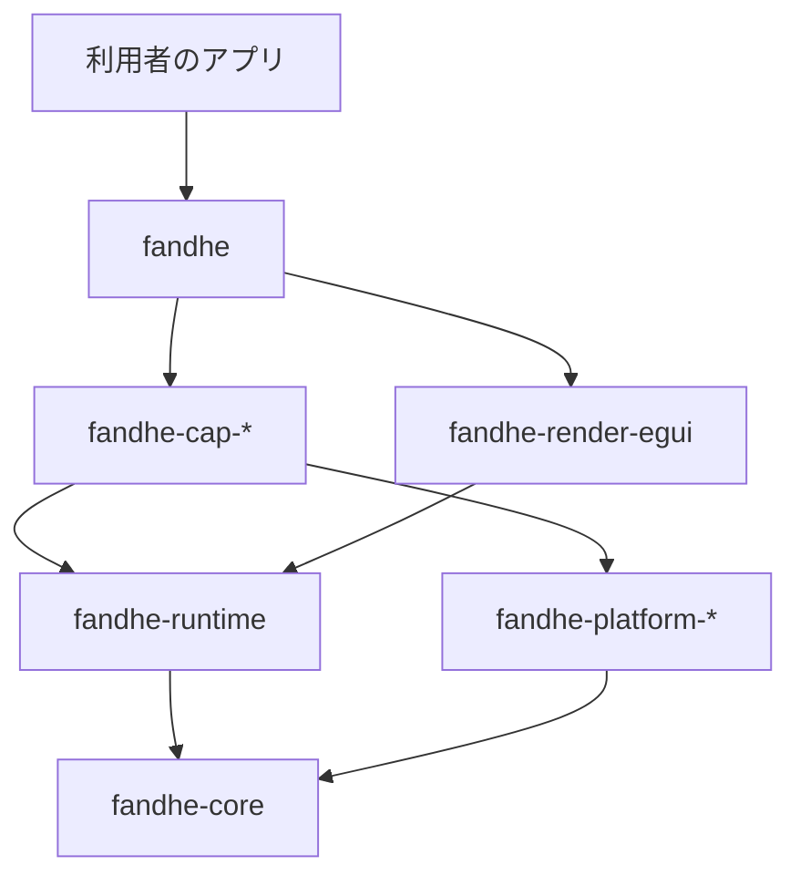

# 利用者向け構造の設計記録

- 状態: 採用
- 対応: #1155、REQ-21 / TASK-21.1（M8）

## 1. 位置づけ

本書は、利用者が使う端末機能だけを選んでアプリを作れる構造への移行方針を記録します。

- 本書を入れた時点で `crates/` は未移行です。構造の実装は #1155 配下の後続 issue で進めます（`fandhe-gallery` は #1165 で追加済み）
- 本書より古い文書と食い違う場合は、本書を正とします
- 古い文書の「独自レンダラ」は、第 2 バックエンドの候補と読み替えます
- #1194 までは旧構造（`feature device`、手書きの設定、`fandhe-egui-proxy/src/device/`）が併存します。
  併存そのものは欠陥として扱いません

## 2. 決定の要約

- 機能と crate は 1 対 1 にします
- 宣言（権限・依存・コンポーネント）の正本は、機能 crate の `Cargo.toml` に置きます
- 各 OS のネイティブ設定は、宣言から生成する成果物にします
- 端末機能はレンダラから分離します
- egui は v1 の既定バックエンドにします
- 5 機能で実証してから、全機能へ反映します

## 3. crate の一覧と公開単位

判定規則は「入口 crate `fandhe` から到達する crate と CLI を公開し、それ以外は `publish = false`」です。
crates.io では、公開する crate の通常依存も公開が要るためです。版は全 crate で揃えます（#1216）。
名前は仮置きで、#1215 で確定します。

| crate | 役割 | 公開 | 由来・担当 issue |
|-------|------|------|-----------------|
| `fandhe` | 入口。機能は optional 依存の feature で選ぶ | する | #1199 |
| `#[fandhe::main]` 用の proc-macro crate（`fandhe-macros`、名前は仮） | 各 OS の入口を生成。proc-macro は別 crate が必須 | する | #1200 |
| `cargo-fandhe` | Rust 製 CLI（`gen`・`run`・`build`） | する | #1176・#1201 |
| `fandhe-core` | UI DSL・状態管理 | する | 既存 |
| `fandhe-runtime` | 起床・完了通知・要求追跡（`RequestSlot`）・画素の受け渡し枠（`image_store`）・`Renderer` trait・描画層の観測値と操作（`HostView`、`Renderer` には載せず `RepaintWaker::host_view` で届ける）。egui 非依存 | する | #1162・#1163・#1302 |
| `fandhe-render-egui` | egui 実装。公開 API に eframe の型を出さない | する | #1164 |
| `fandhe-fonts` | `fandhe-render-egui` の依存 | する | 既存 |
| `fandhe-platform-android` / `-apple` / `-windows` / `-web` | 機能をまたいで共有する OS 層。`-windows` は HWND の保持と COM 初期化ガードだけを持ち、`windows` crate の feature は共通層が最小限（`Win32_Foundation`・`Win32_System_Com`）、各機能 crate が自分の分を宣言する | する | #1166・#1168・#1184・#1185 |
| `fandhe-cap-<id>` | 1 機能 1 crate。OS 別実装・ObjC・Java・`build.rs`・宣言を同居 | する | #1170〜#1174、第 5 Phase |
| `fandhe-web-dom` | Web の DOM 出力 | する | 既存 |
| `fandhe-gallery` | 全機能を載せるカタログ（実機確認用）。画面の登録と各 OS の最終成果物（デスクトップ・iOS の bin、Android・Web の cdylib）を持つ。#1194 までは端末機能を `fandhe-egui-proxy` に依存する | しない | #1165（追加済み） |
| `fandhe-prototype` | 検証用プロトタイプ | しない | 既存 |
| `fandhe-winit-ime` | 入口から到達しない。第 2 バックエンド着手時に判断 | しない | 既存 |
| `fandhe-swiftui-bridge` | watchOS / visionOS 用。入口から到達しない | しない | 既存 |
| `fandhe-egui-proxy` | 上記へ分解して消す | 消滅 | #1164〜#1168・#1194 |
| `fandhe-device` | 機能 crate へ移した後に残る、OS に触れない共有の型・検証・定数・符号化（宣言は持たない）。縮小して残す。名前は #1215 で決める。残りの整理は #1194 | する（機能 crate の通常依存になるため） | #1183・#1194 |

依存は `fandhe-core` へ向かう一方向です。

### 3.1 採用しなかった案

- 1 crate + feature 方式: 利用者の選ぶ操作は同じで、宣言の 0 件も実現できます。採らない理由は次の 3 つです
  - 選ばなかった機能を構造で外せません。全機能の `cfg` を正しく書く必要があり、漏れると権限や API 参照が成果物に混ざります。
    crate を分ければ、選ばなかった機能は依存グラフに載らず、ビルドもされません
  - 第三者の機能は外部 crate になるので、標準機能と形が分かれます
  - 機能の間に境界ができません。`build.rs`・ObjC・Java・宣言が 1 crate に集まり、1 機能の修正でも全体をビルドし直します
- 束ね feature（「通信系」「センサー系」など）: 対応表の group は 4 種で、大半が 1 つの group に偏るため、
  意味のある束になりません

### 3.2 プラグインの扱い

第三者が機能 crate を作れるよう、契約（trait・宣言・登録）だけを公開します。配布の仕組みは作りません（#1203）。
標準機能も `fandhe` の feature を経由せず依存の追加で使える形にし、第三者の機能と同じ選び方を残します。

## 4. 宣言の形式の方針

- 正本は各機能 crate の `[package.metadata.fandhe]` です。`cargo metadata` で解決した依存だけが生成に入ります。
  選ばなかった機能の権限が最終成果物に出ないことが、最小権限の根拠です
- 対応表（`docs/device/capabilities/`）は計画情報だけを持ちます。移行は #1195 で行い、それまでは現行どおりです
- 生成先は `gen/` で、gitignore します。利用者が手を入れる逃げ道は、TOML の追記と `--eject` の 2 つだけにします（#1202）
- 権限の説明文は既定値を持たず、利用者が書きます。有効な機能の説明文が無ければエラーにします。
  既定の文言のまま審査に出る事故を避けるためです
- Java はソース配布にします（#1216 で同梱を確かめます）。アプリの applicationId と独立した固定パッケージ `com.fandhe.platform`（仮名、公開前に確定）へ移しました（#1167）。
  JNI シンボルが利用者の applicationId に依存しないようにするためです
- 利用者の `MainActivity` に機能固有のコードを書かせません（#1257）。機能の追加・削除は依存の追加・削除だけで済ませます。
  - Rust から Java へは、機能 crate の Java が持つ static メソッドを JNI で直接呼びます（`fandhe-platform-android` の
    `with_activity_class` が Activity の class loader でクラスを解決します。ネイティブスレッドの `FindClass` はアプリのクラスを見つけられません）。
    Activity は第 1 引数で渡します。Activity ごとの状態は helper の表（`WeakHashMap`、破棄時に外す）に持ち、表に無ければ
    Java が `false` を返して Rust が失敗として返します（成功へ畳みません）
  - Activity のライフサイクルへの参加は、機能ごとの非公開 `ContentProvider`（共通層の `FeatureLifecycleProvider` を継承）が
    行います。provider は OS がプロセス開始時に生成し、`ActivityLifecycleCallbacks` で `GameActivity` の生成・状態保存・破棄だけを
    機能の helper へ流します。provider は宣言の `android.components`（`kind = "provider"`、`authorities` は
    `${applicationId}.fandhe.<id>`）で出ます。`registerForActivityResult` は登録キーを明示し、生成順への依存を残しません
  - Activity の入力（`dispatchKeyEvent`・`dispatchGenericMotionEvent` 等）の観測は、provider が `onHostCreated` で
    `Window.Callback` を包んで行います（#1303、ゲームパッド）。包んだ callback は Activity より前に呼ばれ、従来の override と
    同じイベントを受けます。通知してから元の戻り値をそのまま返し、イベントは消費しません。AppCompat も同じ方法で
    包んでおり、どちらが外側でも委譲は連なります。守らない範囲は、起動後に `getWindow().setCallback()` で callback を
    差し替えた場合に入力が届かなくなることです。`Activity` 内の他の経路（`onNewIntent` など）は `ComponentActivity` のリスナーで足りるため、この方法は入力の観測に限ります
  - 利用者の `MainActivity` に要るのは `GameActivity` の継承と、`static` 初期化子での `System.loadLibrary` だけです
  - 採らなかった案: `gen` が委譲コードを生成する（出力と宣言の欄が増える。`gen` は現状 `MainActivity` を出さず、`--eject` も未実装）、利用者の手順書で委譲を案内する（「機能を選ぶだけ」が崩れる）、共通の基底 Activity に集める（機能の一覧を知る手段が別に要る）、
    単一 provider に meta-data を集める（同名コンポーネントの異なる定義を拒否する現行の統合規則に欄の追加が要る）
  - 機能が数十に増えて起動時間が問題になれば、`androidx.startup` 型の単一 provider へ寄せます（Phase 5 で計測してから）
- 細かい形式と検証・統合の規則は `capability-declaration.md` に定めました（#1160）。
  本書は 5 節の表で「形式が表せなければならない種類」だけを定めます

## 5. 先行する 5 機能の選定理由

宣言の種類が重ならない 5 つを選び、形式と生成の抜けを 164 機能へ広げる前に見つけます。

| 機能 | 代表する種類 | 形式と生成に課す要求 | 備考 |
|------|-------------|---------------------|------|
| `camera-capture` | 権限と説明文だけで動く | Android の権限・`uses-feature`（`required=false`）、Apple の usage description | iOS は実機確認済みで、退行の比較に使える |
| `document-scan` | GMS と Gradle 依存 | Gradle 依存（ML Kit）、iOS の framework。`NSCameraUsageDescription` を `camera-capture` と共有するため、機能間の重複を統合する | |
| `nfc-card-emulation` | Android のコンポーネント宣言 | `<service>` と `res/xml`。`android.permission.NFC` は他機能と重複する | iOS は Apple の申請待ちで範囲外 |
| `share-receive` | 既存 Activity への追記と有料 entitlement | Activity への intent-filter、macOS の `NSServices`、iOS の App Group と拡張 | iOS は #1211 |
| `home-widget` | 別ターゲット | Android の `<receiver>`、Apple の拡張ターゲットと App Group、Windows のパッケージ ID | iOS は #1212、Windows は #1208 |

範囲の詳細は #1170〜#1174 に従います。

## 6. 2 つの判定の基準

### 6.1 全機能へ反映するか（#1181）

- 有料登録を待ちません
- 進む条件は次の 3 つすべてです
  - 選ばなかった機能の宣言が 0 件であることを機械的に検査できる（#1178、`cargo fandhe verify-scope`。capability-declaration.md §8）
  - 別リポジトリの最小アプリが動く（#1177）
  - 既存アプリの 1 画面が動く（#1180）
- #1179 の計測は判断材料です。数値はリポジトリに置きません
- 5 機能で検収を自動化できなければ、全機能へ進まず構造案を見直します

### 6.2 公開してよいか（#1214 → #1227 → #1217）

- 条件がそろっても自動では公開しません。人が go と判断してから進めます（#1227）。1.0 への移行も同じです
- 判断の材料は TestFlight と Play の内部テストの受理です
- 前提は #1210（人手）、#1206（文書だけで新規アプリを作れる）、#1216（`cargo package` だけでビルドできる）です
- 利用者を受け入れる準備として、対応水準（#1220）、保証する範囲（#1221）、貢献の手順（#1222）、脆弱性の報告（#1223）、
  版と互換性（#1224）、対応する Rust の最低版（#1225）、docs.rs（#1226）を整えます
- 受理の証跡はリポジトリに置きません

## 7. 端末機能とレンダラの分離、egui の位置づけ

- 機能 crate は `fandhe-runtime` と `fandhe-platform-*` に依存し、egui に依存しません。
  レンダラを差し替えても機能 crate を変えずに済ませるためです
- `Renderer` trait は 0.1 から公開します。第 2 実装は今は作りません（#1163）
- `PaintCommand` は core の `Widget::paint` が返すので、定義を `fandhe-core` に残し、`fandhe-runtime` から再公開します。
  runtime へ移すと依存が循環するためです
- egui は v1 の既定バックエンドです。現行の Mac・iOS・Android・Web の実描画と全端末機能の確認がこの上に載っています
- 独自レンダラ（`wgpu`）は第 2 バックエンドの候補です。M4 の実機計測で性能要件を満たせないときに着手します
- Web の機能実装は `fandhe-platform-web` の `Applier` と解放フック（`on_mount_release`）を使い、`fandhe-web-dom` に依存しません。
  `web-sys` の feature は使う crate が自分の `Cargo.toml` に書きます。#1194 までは未移行の機能が `fandhe-web-dom` に残り、
  その解放は `fandhe-web-dom` がまとめて登録します（#1185）
- 引き継ぐ制約
  - Web の canvas は支援技術へ公開されないので、DOM 出力（`fandhe-web-dom`）を残します（`dom-output-architecture.md`）
  - watchOS / visionOS は REQ-3 の別構成のままです（`req3-implementation-policy.md`）
  - IME は egui 経由の迂回を使います（`ime-known-constraints.md`）

## 8. 機能 crate が共有するコードの扱い（#1183）

先行 5 機能の実績に合わせ、後から機械的に動かし直せる側を選びました。移す手順は
`docs/operations/capability-crate-migration.md`、道具は `scripts/device/migrate-capability.mjs` です。

| 種類 | 行き先 |
|------|--------|
| 1 機能だけが使う契約・型 | その機能 crate |
| エラー型 | 共有しない。crate ごとに `<Pascal>Error` を持ち、使うバリアントだけを写す。表示文言は `DeviceError` と同じ書き出しにしてテストで固定する |
| 他機能の OS 機能を実際に使う（例: `geofence` → `location`、`background_task` → `storage`） | 機能 crate から機能 crate へ依存する。依存先の宣言も一緒に入るため、権限の実態と合う |
| OS に触れない型・検証・定数・符号化を 2 機能以上が使う（例: `url_scheme`・`photo_picker::PickedPhoto`・`http::check_url`） | `fandhe-device` に残す。機能 crate 同士で依存させない（使わない機能の権限・コンポーネントが宣言に混ざるため） |
| OS 層の定型（JNI・main thread・再描画・保存先の解決） | `fandhe-platform-<os>`・`fandhe-runtime` |

- 利用者は `fandhe-device` に直接依存しません。使うのは機能 crate で、共有型は機能 crate が再公開します
- `fandhe-device` は `forbid(unsafe_code)` を保ち、OS API を呼びません。`DeviceError` の削除と残ったモジュールの整理は #1194 です

### 8.1 画面と effect ドライバの置き場

- 画面の状態機械は `fandhe-core/src/screens/` に残します（`fandhe-web-dom` が同じ型を使うため。移行を挙動の変わらない移動に保ちます）
- effect ドライバは機能 crate の `src/driver.rs` に置きます。`fandhe_core::screens` を参照してよいのは `driver.rs` だけです。
  契約と OS 実装は画面の状態型に依存させません
- 入口 crate `fandhe`（#1199）からは契約だけを再公開し、ドライバは再公開しません

### 8.2 汎用の機能と、フレームワークの外からの使い方

- HTTP・保存・クリップボードも他と同じ 1 機能 1 crate にします（`fandhe-cap-http-get`・`fandhe-cap-local-storage-kv`・`fandhe-cap-clipboard`）
- 全機能 crate は、画面の状態型に依存しない入口 `pub fn platform_<stem>()` と trait を crate ルートから公開します。
  フレームワークの外のアプリはこれを使い、effect は自分の状態型で書きます（実例: `fandhe-cap-device-identifier`）。
  公開の有無は `node scripts/device/migrate-capability.mjs sync --check` が検査します
- 保存先の解決（Android の `data_dir`・iOS の `documents_dir`・デスクトップの既定）は `fandhe-cap-local-storage-kv` が持ちます。
  他機能は「OS 機能を実際に使う」場合として依存します

## 9. 未決事項

いずれも本書では決めません。担当 issue を併記します。

- 版の方針（#1224）。0.x の間は全 crate で揃えます。1.0 以降は `fandhe-runtime` の契約を安定させ、
  機能 crate を別々に上げられる形が推し案です
- 機能と OS ごとの対応水準（#1220）と、公式で保証する範囲（#1221）
- `fandhe-platform-apple` の弱リンク・`-rpath`・clang_rt の届け方（#1168 の後続）。
  `cargo:rustc-link-arg` は、出した package 自身の bin・cdylib・テストにしか効かず、依存元へ伝わりません
  （Cargo の build-scripts 文書の `rustc-link-arg` 節）。`rustc-link-lib` は rlib 経由で伝わります。
  Swift 薄層（`compile_swift`）と弱リンクの framework（`weak_link_framework`）はこの制約を受けるため、
  rlib の機能 crate の `build.rs` から呼ぶと最終成果物へ届きません。先行 5 機能は Swift 薄層も弱リンクも
  使わないので影響せず、該当機能を移すときに解決します。現状の呼び出し元は最終成果物を作る
  `fandhe-egui-proxy` 自身のため、動作は変わりません
- Linux の `fandhe-platform-*` は作りません。対応表に Linux の列が無いためです。必要になったら足します
- 名前の確定と予約（#1215）、Windows のパッケージ ID（#1208）。
  `windows-package-identity-consideration.md` は提案のままです
- crates.io の新規 crate 公開の制限は未確認です（#1217 で確かめます）
