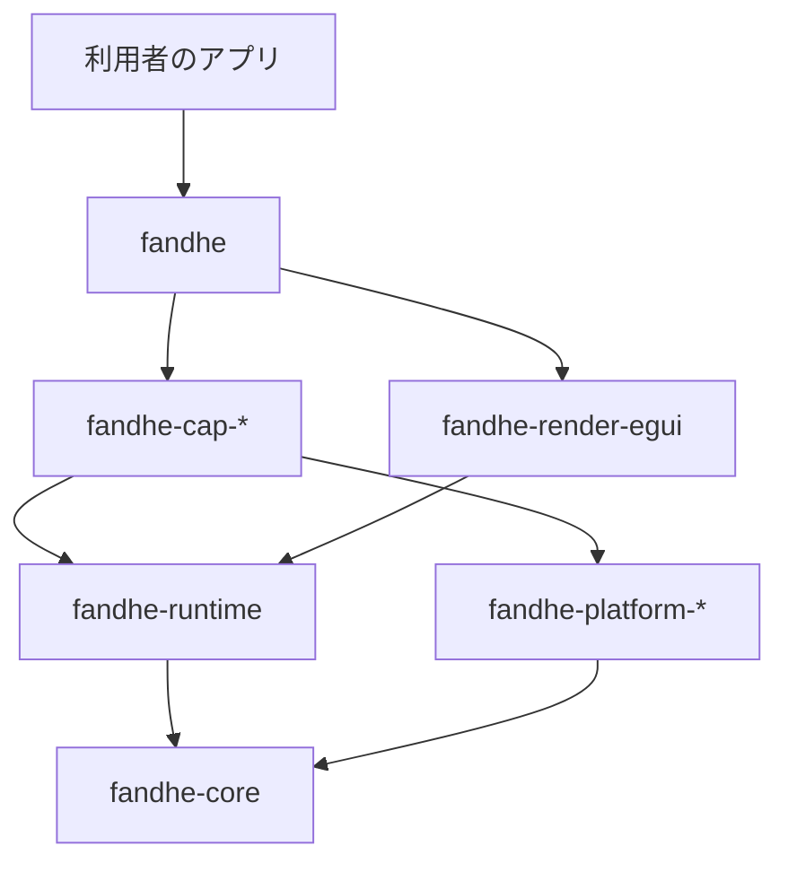

# 利用者向け構造の設計記録

- 状態: 採用
- 対応: #1155、REQ-21 / TASK-21.1（M8）

## 1. 位置づけ

本書は、利用者が使う端末機能だけを選んでアプリを作れる構造への移行方針を記録します。

- 本書を入れた時点で `crates/` は未移行です。構造の実装は #1155 配下の後続 issue で進めます
- 本書より古い文書と食い違う場合は、本書を正とします
- 古い文書の「独自レンダラ」は、第 2 バックエンドの候補と読み替えます
- #1194 までは旧構造（`feature device`、手書きの設定、`fandhe-egui-proxy/src/device/`）が併存します。
  併存そのものは欠陥として扱いません

## 2. 決定の要約

- 機能と crate は 1 対 1 にします
- 宣言（権限・依存・コンポーネント）の正本は、機能 crate の `Cargo.toml` に置きます
- 各 OS のネイティブ設定は、宣言から生成する成果物にします
- 端末機能はレンダラから分離します
- egui は v1 の既定バックエンドにします
- 5 機能で実証してから、全機能へ反映します

## 3. crate の一覧と公開単位

判定規則は「入口 crate `fandhe` から到達する crate と CLI を公開し、それ以外は `publish = false`」です。
crates.io では、公開する crate の通常依存も公開が要るためです。版は全 crate で揃えます（#1216）。
名前は仮置きで、#1215 で確定します。

| crate | 役割 | 公開 | 由来・担当 issue |
|-------|------|------|-----------------|
| `fandhe` | 入口。機能は optional 依存の feature で選ぶ | する | #1199 |
| `#[fandhe::main]` 用の proc-macro crate（`fandhe-macros`、名前は仮） | 各 OS の入口を生成。proc-macro は別 crate が必須 | する | #1200 |
| `cargo-fandhe` | Rust 製 CLI（`gen`・`run`・`build`） | する | #1176・#1201 |
| `fandhe-core` | UI DSL・状態管理 | する | 既存 |
| `fandhe-runtime` | 起床・完了通知・`Renderer` trait。egui 非依存 | する | #1162・#1163 |
| `fandhe-render-egui` | egui 実装。公開 API に eframe の型を出さない | する | #1164 |
| `fandhe-fonts` | `fandhe-render-egui` の依存 | する | 既存 |
| `fandhe-platform-android` / `-apple` / `-windows` / `-web` | 機能をまたいで共有する OS 層 | する | #1166・#1168・#1184・#1185 |
| `fandhe-cap-<id>` | 1 機能 1 crate。OS 別実装・ObjC・Java・`build.rs`・宣言を同居 | する | #1170〜#1174、第 5 Phase |
| `fandhe-web-dom` | Web の DOM 出力 | する | 既存 |
| `fandhe-gallery` | 全機能を載せるカタログ（実機確認用の bin） | しない | #1165 |
| `fandhe-prototype` | 検証用プロトタイプ | しない | 既存 |
| `fandhe-winit-ime` | 入口から到達しない。第 2 バックエンド着手時に判断 | しない | 既存 |
| `fandhe-swiftui-bridge` | watchOS / visionOS 用。入口から到達しない | しない | 既存 |
| `fandhe-egui-proxy` | 上記へ分解して消す | 消滅 | #1164〜#1168・#1194 |
| `fandhe-device` | trait は各機能 crate へ移す。共有コードは #1183 で決める | 消滅見込み | #1183 |

依存は `fandhe-core` へ向かう一方向です。

### 3.1 採用しなかった案

- 1 crate + feature 方式: 第三者が作る機能 crate と同じ形にならず、宣言が 1 ファイルに集中します。
  機能を選ぶ操作も、依存の追加ではなく feature の編集になり、利用者の負担が増えます
- 束ね feature（「通信系」「センサー系」など）: 対応表の group は 4 種で、大半が 1 つの group に偏るため、
  意味のある束になりません

### 3.2 プラグインの扱い

第三者が機能 crate を作れるよう、契約（trait・宣言・登録）だけを公開します。配布の仕組みは作りません（#1203）。

## 4. 宣言の形式の方針

- 正本は各機能 crate の `[package.metadata.fandhe]` です。`cargo metadata` で解決した依存だけが生成に入ります。
  選ばなかった機能の権限が最終成果物に出ないことが、最小権限の根拠です
- 対応表（`docs/device/capabilities/`）は計画情報だけを持ちます。移行は #1195 で行い、それまでは現行どおりです
- 生成先は `gen/` で、gitignore します。利用者が手を入れる逃げ道は、TOML の追記と `--eject` の 2 つだけにします（#1202）
- 権限の説明文は既定値を持たず、利用者が書きます。有効な機能の説明文が無ければエラーにします。
  既定の文言のまま審査に出る事故を避けるためです
- Java はソース配布にします（#1216 で同梱を確かめます）。固定パッケージへ移します（#1167）。
  JNI シンボルに `com.fandhe.androidapp` が入っており、利用者の applicationId では動かないためです
- 細かい形式は #1160 で決めます。本書は 5 節の表で「形式が表せなければならない種類」だけを定めます

## 5. 先行する 5 機能の選定理由

宣言の種類が重ならない 5 つを選び、形式と生成の抜けを 164 機能へ広げる前に見つけます。

| 機能 | 代表する種類 | 形式と生成に課す要求 | 備考 |
|------|-------------|---------------------|------|
| `camera-capture` | 権限と説明文だけで動く | Android の権限・`uses-feature`（`required=false`）、Apple の usage description | iOS は実機確認済みで、退行の比較に使える |
| `document-scan` | GMS と Gradle 依存 | Gradle 依存（ML Kit）、iOS の framework。`NSCameraUsageDescription` を `camera-capture` と共有するため、機能間の重複を統合する | |
| `nfc-card-emulation` | Android のコンポーネント宣言 | `<service>` と `res/xml`。`android.permission.NFC` は他機能と重複する | iOS は Apple の申請待ちで範囲外 |
| `share-receive` | 既存 Activity への追記と有料 entitlement | Activity への intent-filter、macOS の `NSServices`、iOS の App Group と拡張 | iOS は #1211 |
| `home-widget` | 別ターゲット | Android の `<receiver>`、Apple の拡張ターゲットと App Group、Windows のパッケージ ID | iOS は #1212、Windows は #1208 |

範囲の詳細は #1170〜#1174 に従います。

## 6. 2 つの判定の基準

### 6.1 全機能へ反映するか（#1181）

- 有料登録を待ちません
- 進む条件は次の 3 つすべてです
  - 選ばなかった機能の宣言が 0 件であることを機械的に検査できる（#1178）
  - 別リポジトリの最小アプリが動く（#1177）
  - 既存アプリの 1 画面が動く（#1180）
- #1179 の計測は判断材料です。数値はリポジトリに置きません
- 5 機能で検収を自動化できなければ、全機能へ進まず構造案を見直します

### 6.2 公開してよいか（#1214 → #1217）

- TestFlight と Play の内部テストに受理されることが条件です
- 前提は #1210（人手）、#1206（文書だけで新規アプリを作れる）、#1216（`cargo package` だけでビルドできる）です
- 受理の証跡はリポジトリに置きません

## 7. 端末機能とレンダラの分離、egui の位置づけ

- 機能 crate は `fandhe-runtime` と `fandhe-platform-*` に依存し、egui に依存しません。
  レンダラを差し替えても機能 crate を変えずに済ませるためです
- `Renderer` trait は 0.1 から公開します。第 2 実装は今は作りません（#1163）
- egui は v1 の既定バックエンドです。現行の Mac・iOS・Android・Web の実描画と全端末機能の確認がこの上に載っています
- 独自レンダラ（`wgpu`）は第 2 バックエンドの候補です。M4 の実機計測で性能要件を満たせないときに着手します
- 引き継ぐ制約
  - Web の canvas は支援技術へ公開されないので、DOM 出力（`fandhe-web-dom`）を残します（`dom-output-architecture.md`）
  - watchOS / visionOS は REQ-3 の別構成のままです（`req3-implementation-policy.md`）
  - IME は egui 経由の迂回を使います（`ime-known-constraints.md`）

## 8. 未決事項

いずれも本書では決めません。担当 issue を併記します。

- `PaintCommand` の置き場（#1163）。core の `Widget::paint` が返すため、runtime へ移すと循環します。
  推し案は、定義を core に残して runtime から再公開することです。#1163 の受入基準と文言の調整が要ります
- `fandhe-device` の共有コードの行き先（#1183）
- 宣言で macOS の欄・Android のコンポーネントとリソース・Apple の拡張ターゲットをどう表すか（#1160）。
  #1160 の本文に挙がる欄だけでは、5 節の要求を満たしません
- 端末機能の画面（`fandhe-core/src/screens/`）の置き場（#1165・#1170 系）
- Linux の `fandhe-platform-*` は作りません。対応表に Linux の列が無いためです。必要になったら足します
- 名前の確定と予約（#1215）、Windows のパッケージ ID（#1208）。
  `windows-package-identity-consideration.md` は提案のままです
- crates.io の新規 crate 公開の制限は未確認です（#1217 で確かめます）
