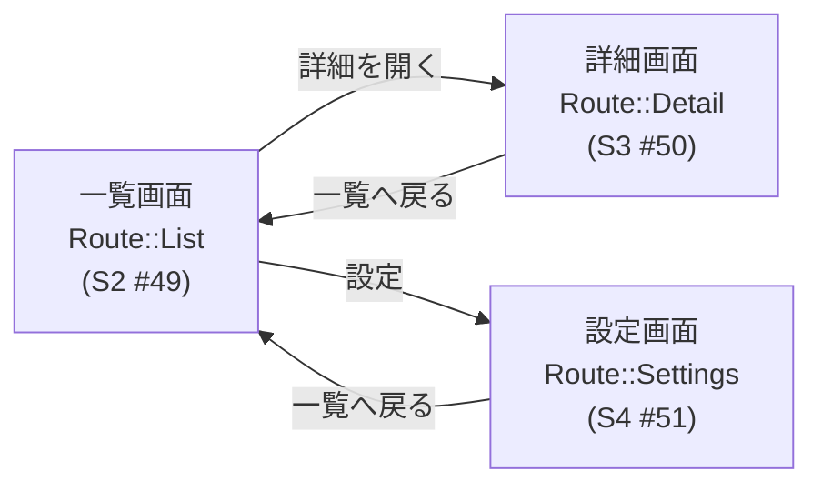
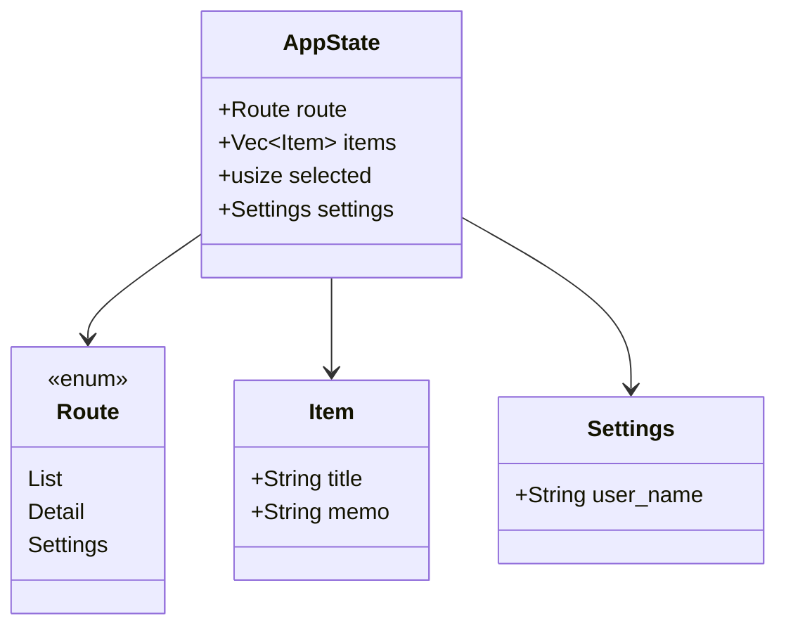
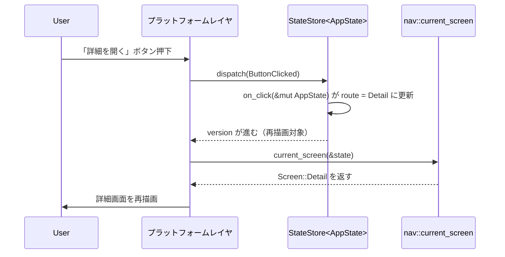

# プロトタイプアプリの画面構成・状態設計

## 1. 目的・位置づけ

本書は issue #48（TASK-2.2-S1、親 issue #47 = TASK-2.2 の sub-issue 1/6）の成果物であり、
REQ-2（`docs/spec/04-requirements.md` L46〜49）の受け入れ基準「複数画面プロトタイプで共通コード比率を
再計測する」ための母集団を構成するプロトタイプアプリ（3〜5 画面規模）の**画面構成・状態設計**を確定する。

- **PoC-1 実測**: 70/126 行 ≈ 55.6%（`docs/spec/03-poc/ui-rendering/README.md`）。画面数増加による
  固定費希釈で 70% 到達を狙う（親 issue #47 の狙い）。
- **兄弟 sub-issue の分担**: S2 #49（一覧画面）・S3 #50（詳細画面）・S4 #51（設定画面）・
  S5 #52（画面間ナビゲーション・状態共有）・S6 #53（共通/プラットフォーム別コードの分類・行数計測準備）。
  本書はこれらが並列に着手できるよう、画面構成・状態型・ルーティングモデル・DSL 制約由来の設計判断・
  クレート構成の 5 点を確定記載する。
- **前提**: `crates/fandhe-core`（TASK-1.1、`#![forbid(unsafe_code)]`）が提供する
  `Screen<S>` / `Node<S>`（`Text` / `TextField` / `Button` / `List`）・`Event` / `StateStore<S>`・
  `ReadFn<S, T>` / `WriteFn<S, T>`（クロージャ環境キャプチャ拒否、REQ-13 / NFR-9）。

## 2. アプリ題材と画面構成

題材は「タスクメモ」アプリ（項目の一覧・詳細編集・設定）とし、3 画面＋ルーティングで構成する
（3〜5 画面の要件内）。



| 画面 | Route | 主なノード構成（S2〜S4 で本実装） |
|------|-------|--------------------------------|
| 一覧画面 | `Route::List` | 見出し `Text`・項目一覧 `List`（状態から展開）・「項目を追加」`Button`・選択移動「次へ/前へ」`Button`・「詳細を開く」`Button`・「設定」`Button` |
| 詳細画面 | `Route::Detail` | 選択中項目のタイトル `Text`・メモ編集 `TextField`・「一覧へ戻る」`Button` |
| 設定画面 | `Route::Settings` | 見出し `Text`・ユーザー名 `TextField`・「一覧へ戻る」`Button` |

## 3. 状態設計（単一状態型 `AppState`）

`Node<S>` の状態アクセスが関数ポインタ限定（`S` 固定）であるため、全画面で共有する単一の状態型を
採用する（S5 の「状態共有」の土台）。



実体は `crates/fandhe-prototype/src/state.rs`:

```rust
/// 現在表示中の画面を表すルーティング ID（既定は List）
#[derive(Debug, Clone, Copy, PartialEq, Eq, Default)]
pub enum Route { #[default] List, Detail, Settings }

/// 一覧・詳細で共有される 1 項目
pub struct Item { pub title: String, pub memo: String }

/// 設定画面が扱う設定値（S4 #51 でフィールド追加可）
#[derive(Default)]
pub struct Settings { pub user_name: String }

/// プロトタイプ全体の共有状態（AI 型安全 DSL の方針どおり
/// 書き込みは StateStore::dispatch 経由の関数ポインタに限定）
#[derive(Default)]
pub struct AppState {
    pub route: Route,
    pub items: Vec<Item>,
    pub selected: usize,   // 詳細画面の対象（items 添字、境界は saturating で防御）
    pub settings: Settings,
}
```

状態アクセサ（`get_memo` / `set_memo` / `get_user_name` / `set_user_name`）はすべて関数ポインタとして
定義し、`fandhe_core::state::ReadFn` / `WriteFn` へ代入可能であることをコンパイル時定数
（`const _: ReadFn<..> = get_memo;` 等）で固定化している。`selected` の範囲外アクセスは
`saturating`/`min` により防御し、panic を API 契約にしない（coding-rust.md 準拠）。

## 4. ナビゲーションモデル

- `route` を `AppState` のフィールドとして持ち、画面遷移も「ボタン押下 → `fn(&mut AppState)` が
  `route` を書き換える → `StateStore::version` が進む → プラットフォーム側が `current_screen(state)` を
  引き直す」という**既存のイベント→状態更新配線の特殊例**として設計する。fandhe-core への変更・
  新規ナビゲーション機構の追加は不要（= 共通コード比率にも有利）。
- `current_screen(&AppState) -> Screen<AppState>`（`crates/fandhe-prototype/src/nav.rs`、
  ディスパッチのみ実装）が `route` に応じて `list_screen()` / `detail_screen()` /
  `settings_screen()` を返す。



- 遷移ハンドラ `go_to_list` / `go_to_detail` / `go_to_settings` / `select_next` / `select_prev` の
  **シグネチャと責務**（本書で確定、実装・遷移テストは S5 #52 に委ねる）:

| ハンドラ | シグネチャ | 責務 |
|---------|-----------|------|
| `go_to_list` | `fn(&mut AppState)` | `route` を `Route::List` にする |
| `go_to_detail` | `fn(&mut AppState)` | `route` を `Route::Detail` にする（`selected` は変更しない） |
| `go_to_settings` | `fn(&mut AppState)` | `route` を `Route::Settings` にする |
| `select_next` | `fn(&mut AppState)` | `selected` を `items` の範囲内で 1 つ進める（末尾では据え置き） |
| `select_prev` | `fn(&mut AppState)` | `selected` を 1 つ戻す（先頭では据え置き、`saturating_sub`） |

## 5. DSL 制約に由来する設計判断

- **項目選択の間接化**: `Node::Button::on_click` は `fn(&mut S)` 固定でペイロードを持たず、
  `Event::ButtonClicked` はラベル文字列一致で発火する。リスト項目ごとの動的ボタンは「押された項目の
  特定」ができない（`List` 展開内ノードは `dispatch` の線形走査対象外でもある）。よって選択は
  `selected` 添字を「次へ/前へ」ボタンで移動する方式とする（上表 `select_next` / `select_prev`）。
- **ペイロード付きイベントの DSL 拡張はスコープ外**: 項目 ID 付きクリックのような機構は本タスクの
  スコープ外とする。必要性が確認された場合は `.claude/rules/out-of-scope-tracking.md` のフローで扱う
  （spec 要件変更に相当するため、確定した場合は spec リポジトリ側への報告候補となる）。自動運転での
  本 issue 実装では Issue 起票は行わず、本書と PR 本文への記録にとどめる。

## 6. コード配置（共通/プラットフォーム別分類の前提、S6 #53 への引き継ぎ）

> 本章は S1 時点の暫定方針。分類基準の確定版は S6 で作成した
> `docs/architecture/code-ratio-classification.md` を参照すること（本章と内容が食い違う場合は
> 確定版を優先する）。

プロトタイプの共通コードを独立クレート `crates/fandhe-prototype` に隔離し、
S6 の行数計測（分子 = 共通）をクレート単位で機械的に行えるようにする。

```
crates/fandhe-prototype/          # 共通コード（fandhe-core のみに依存、forbid(unsafe_code)）
├── Cargo.toml
└── src/
    ├── lib.rs        # クレートドキュメント・re-export
    ├── state.rs      # AppState / Route / Item / Settings ＋ 状態アクセサ関数
    ├── nav.rs         # current_screen ルーティング（ディスパッチのみ実装、遷移ハンドラは S5）
    └── screens/
        ├── mod.rs
        ├── list.rs      # list_screen() 最小スタブ（本実装は S2 #49）
        ├── detail.rs    # detail_screen() 最小スタブ（本実装は S3 #50）
        └── settings.rs  # settings_screen() 最小スタブ（本実装は S4 #51）
```

- スタブは「タイトル＋見出し `Text` 1 個」の最小 `Screen<AppState>` を返す（コンパイル・テスト可能な
  骨組み）。S2〜S4 が各ファイルを独立に本実装するため、ファイル分割で並列時のコンフリクトを最小化する。
- **分類方針**（確定計測は S6）: `crates/fandhe-prototype` = 共通コード（分子・分母）、描画起動のために
  プラットフォーム側（`fandhe-egui-proxy` 等）へ追加する差分 = プラットフォーム別コード（分母のみ）。
  フレームワーク本体（`fandhe-core`）は母集団外。

## 7. sub-issue 分担境界（受け渡し一覧）

| sub-issue | スコープ | 本 issue（S1）が提供する土台 |
|-----------|---------|------------------------------|
| S2 #49（一覧画面） | `list_screen()` の本実装 | `screens/list.rs` のスタブ・`AppState`/`Item` |
| S3 #50（詳細画面） | `detail_screen()` の本実装 | `screens/detail.rs` のスタブ・`get_memo`/`set_memo` |
| S4 #51（設定画面） | `settings_screen()` の本実装 | `screens/settings.rs` のスタブ・`get_user_name`/`set_user_name` |
| S5 #52（ナビゲーション・状態共有） | 遷移ハンドラ本体・遷移/状態共有テスト・`fandhe-egui-proxy` の描画対象切替 | `current_screen` ディスパッチ・遷移ハンドラのシグネチャ確定（本書 4 章） |
| S6 #53（分類・計測） | 共通/プラットフォーム別コードの分類確定・行数計測ツール整備 | クレート分割（本書 6 章）・分類方針 |

## 8. スコープ外（本 issue に含まないもの）

- 各画面のノード本実装（S2 #49 / S3 #50 / S4 #51）
- 画面遷移ハンドラの実装・遷移/状態共有テスト・`fandhe-egui-proxy` の描画対象切替（S5 #52）
- 共通/プラットフォーム別コードの分類確定・行数計測ツール整備（S6 #53、本書は分類方針のみ提示）
- ペイロード付きボタンイベント等の DSL 拡張（必要性が確定した場合に out-of-scope-tracking.md の
  フローで扱う。spec 要件変更に相当するため spec リポジトリ側への報告候補）
