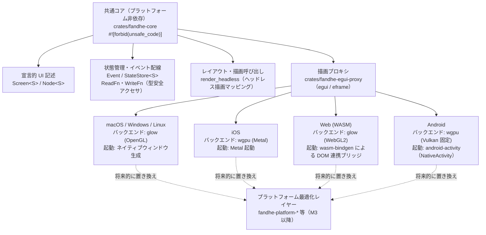

# 責務分界アーキテクチャ図（本実装版）

## 1. 目的・位置づけ

本書は TASK-2.1（`docs/spec/05-tasks.md` L66〜71）の成果物であり、REQ-2（`docs/spec/04-requirements.md`
L42〜50）の受け入れ基準 1「共通コアとプラットフォーム最適化レイヤーの責務分界がアーキテクチャ図として
文書化されている（PoC-1 の境界図を踏襲）」（`04-requirements.md` L47）を満たすために、PoC-1
（`docs/spec/03-poc/ui-rendering/README.md`、実施日 2026-07-08）の境界図（L59〜79）を、本実装フェーズの
現状（`crates/fandhe-core`、TASK-1.1 完了分）へ対応づけて更新したものです。

- **参照元**: PoC-1 の境界図（`docs/spec/03-poc/ui-rendering/README.md` L59〜79、ASCII 図は L61〜75）。
  本書はこの境界図の構造（共通コア 1 層＋プラットフォーム別 4 分岐）を踏襲し、Mermaid 図として書き起こした
  上で、現行実装 API・M2 段階の実装形態（`egui`/`eframe` プロキシ経由）への対応を追記しています。
- **`docs/spec/` との関係**: `docs/spec/` は読み取り専用サブモジュールのため、本書は本リポジトリ側
  （`docs/architecture/`）の新規ドキュメントとして作成しています。spec 自体の変更はこのリポジトリでは
  行いません（`docs/architecture/crate-feature-matrix.md` と同じ置き場・体裁）。
- **ロードマップ上の位置づけ**: `docs/spec/06-roadmap.md`（M2、L30〜58）は TASK-2.1 を M2 の完了基準の 1 つ
  として掲げており（L52「共通コアとプラットフォーム最適化レイヤーの責務分界がアーキテクチャ図として
  文書化されている（TASK-2.1）」）、TASK-2.1 の成果物として本書を置きます。
- **前提タスク**: TASK-1.1（`crates/fandhe-core` に `Screen<S>`/`Node<S>`・状態アクセサ・
  イベント配線・サンプル画面が実装されている）。

## 2. 責務分界アーキテクチャ図

PoC-1 の境界図（共通コア 1 層＋プラットフォーム別 4 分岐: macOS/Win/Linux＝`glow`、iOS＝`wgpu`(Metal)、
Web＝`glow`(WebGL2)＋`wasm-bindgen`、Android＝`wgpu`(Vulkan、想定)＋`android-activity`）の構造を踏襲し、
本実装の現状に対応づけたものが下図です。

- **共通コア**: `crates/fandhe-core` が「宣言的 UI 記述＋状態管理＋レイアウト・描画呼び出し」
  までをプラットフォーム非依存に保つ層です。`Screen<S>`/`Node<S>`（UI 記述）、
  `Event`/`StateStore<S>`（イベント発生 → 状態 `S` の更新 → 再描画判定の配線）、`ReadFn`/`ReadAccessor`・
  `WriteFn`/`WriteAccessor`（型安全な状態アクセサ）、`render_headless`（レイアウト・描画呼び出しの
  ヘッドレス版マッピング）が該当します。
- **描画プロキシ**: `06-roadmap.md`（M2、L34〜36・L51）が定める通り、
  M2 は基盤クレート（`wgpu`/`taffy`/`cosmic-text`/`winit`）への直接統合ではなく、PoC-1 と同様に
  `egui`/`eframe` プロキシ経由で実描画を行う段階構成です。
- **プラットフォーム最適化レイヤー（M3 以降）**: 「グラフィックスバックエンドの選択」
  「起動・イベントループのブートストラップ」に限定される層です。`fandhe-platform-*` 等として M3 以降
  （プラットフォーム統合クレート追加）に切り出される想定です。
  図中の破線は「現状は `egui`/`eframe` のバックエンド選択がこの責務を暫定的に担っており、M3 以降に
  独立クレートへ置き換わる」という段階的な関係を表します。

## 3. 責務一覧表

| 層 | 責務 | 本実装での対応 | PoC-1 境界図での対応 |
|----|------|---------------|---------------------|
| 共通コア | 宣言的 UI 記述 | `Screen<S>` / `Node<S>`（`crates/fandhe-core/src/ui/`。`Text`・`TextField`・`Button`・`List`） | `DemoApp`（ボタン・リスト・テキスト） |
| 共通コア | 状態管理 | `state::ReadFn<S, T>`/`ReadAccessor`・`state::WriteFn<S, T>`/`WriteAccessor`（関数ポインタ限定の型安全アクセサ、REQ-13） | `counter`, `items`（構造体フィールド直接保持） |
| 共通コア | イベント → 状態更新 → 再描画判定の配線 | `state::Event` / `state::StateStore<S>`（`StateStore::dispatch` が `click_button` 等の走査ロジックへ委譲） | 未分離（`impl eframe::App` 内に混在） |
| 共通コア | レイアウト・描画呼び出し | `ui::render_headless`（ヘッドレス描画マッピング。PoC-6 の `render_headless` を公開 API へ昇格） | `egui::CentralPanel` 等への描画コマンド呼び出し |
| 最適化レイヤー（M2 は暫定的に描画プロキシが代替） | グラフィックスバックエンド選択 | `crates/fandhe-egui-proxy`（`egui`/`eframe` 経由で `glow`/`wgpu` を選択。iOS は Cargo.toml のターゲット分岐、Android は `wgpu::Backends::VULKAN` 固定で arm64-v8a/armeabi-v7a/x86_64 の 3 ABI 対応。iOS 側は TASK-1.3-S1〜S3、Android 側は TASK-1.5-S1〜S3） | macOS/Win/Linux＝`glow`、iOS＝`wgpu`(Metal)、Web＝`glow`(WebGL2)、Android＝`wgpu`(Vulkan)。Web の `WebGlContextOption::WebGl2` 固定・WebGPU 非採用の根拠は `web-rendering-policy.md`（TASK-4.3）参照 |
| 最適化レイヤー | 起動・イベントループのブートストラップ | ネイティブウィンドウ生成 / `wasm_bindgen` の DOM 連携 / Android は `android_main`（`crates/fandhe-egui-proxy/src/android.rs`、`android-activity` の NativeActivity 方式、TASK-1.5-S2、実機/エミュレータでの起動確認は TASK-1.6） | ネイティブウィンドウ生成／`wasm_bindgen` の DOM 連携（37 行）／`android-activity`（`crates/fandhe-egui-proxy/src/android.rs`） |

## 4. 依存方向・境界の規約

`.claude/rules/coding-rust.md` の規約を、本書が扱う責務分界の実装制約として明示します。

- **依存方向は最適化レイヤー → コアの一方向**とし、共通コア（`crates/fandhe-core`）からプラットフォーム
  固有クレートへ依存しません（`crates/fandhe-core/src/lib.rs` 冒頭のクレートコメントで明記済み）。
- 共通コアのクレートには `#![forbid(unsafe_code)]` を付けます（`crates/fandhe-core/src/lib.rs` で適用済み）。
- FFI 境界（プラットフォーム統合レイヤ）で `unsafe` が不可避な場合は、最小範囲の関数・モジュールに閉じ、
  `// SAFETY:` コメントで安全性根拠を明記し、安全な公開 API でラップして `unsafe` を呼び出し側へ漏らしません。
- feature フラグは加法的（additive）に設計し、feature の組み合わせでビルドが壊れないようにします。

## 5. PoC-1 境界図からの差分・残課題

PoC-1 の境界図（`03-poc/ui-rendering/README.md` L77〜79）が明記した残課題を引き続き残課題として扱います。

- **バックエンド選択は UI 記述差分より一段深い分岐である**（PoC-1 発見事項）: `Screen<S>`/`Node<S>` の
  UI 記述自体はプラットフォーム分岐を持たず、分岐はバックエンド選択・ブートストラップの層でのみ生じる
  という PoC-1 の実証結果は、本実装（TASK-1.1）でも UI 記述層にプラットフォーム条件分岐が存在しないことと
  整合しています。
- **境界図に未反映の残課題**（PoC-1 L79 記載を維持）: Android TV のフォーカス機構、iOS/Android の実機
  アクセシビリティ挙動は、プラットフォーム最適化レイヤー側に追加で必要になる可能性が高い要素として、
  本書の図にも反映していません。M3 以降のプラットフォーム統合クレート設計時に改めて検討します。
- **watchOS/visionOS は本書の分界図の対象外**: REQ-3（`04-requirements.md` L53〜65）が定める通り、
  watchOS・visionOS では独自レンダラ（`wgpu`）が Metal API 非提供・ビルド不能という制約
  （PoC-2）により採用できず、Rust コアと SwiftUI を FFI で接続するハイブリッド構成を別途取ります。
  本書が扱う「共通コア＋独自レンダラ系プラットフォーム最適化レイヤー」の分界とは別構成のため、対象外
  とします。

## 6. REQ-2 受け入れ基準・M2 完了基準との整合確認

| 基準 | 内容 | 本書での対応 |
|------|------|-------------|
| REQ-2 受け入れ基準 1（`04-requirements.md` L47） | 共通コアとプラットフォーム最適化レイヤーの責務分界がアーキテクチャ図として文書化されている（PoC-1 の境界図を踏襲） | 本書の「2. 責務分界アーキテクチャ図」「3. 責務一覧表」で対応（**本書のスコープ**） |
| REQ-2 受け入れ基準 2（`04-requirements.md` L48） | 複数画面（3〜5 画面）規模のプロトタイプで共通コードベース比率を再計測し、結果を記録する | TASK-2.2（`05-tasks.md` L74〜、M3・#6 配下の別 issue）のスコープ（本書のスコープ外） |
| REQ-2 受け入れ基準 3（`04-requirements.md` L49） | 再計測後の共通コードベース比率が 70% 未満の場合、KMP 型（ロジック共有＋UI 一部最適化）として価値定義を修正する | TASK-2.3〜2.4（M3・#6 配下の別 issue）のスコープ（本書のスコープ外。再計測結果に依存するため判定不可） |
| `06-roadmap.md` M2 完了基準（L52） | 共通コアとプラットフォーム最適化レイヤーの責務分界がアーキテクチャ図として文書化されている（TASK-2.1） | 本書の作成をもって TASK-2.1 の成果物とする |

## 7. 出典

- [PoC-1: UI レンダリング方式の実現可能性 - README.md](../../docs/spec/03-poc/ui-rendering/README.md)
  （`docs/spec/03-poc/ui-rendering/README.md` L59〜79「アーキテクチャ境界（本プロトタイプで確認した構成）」）
- `docs/spec/04-requirements.md` L42〜50（REQ-2）、L53〜65（REQ-3）
- `docs/spec/05-tasks.md` L64〜71（REQ-2・TASK-2.1）
- `docs/spec/06-roadmap.md` L30〜58（M2）
- `crates/fandhe-core/src/lib.rs`（公開 API の現状。`Screen`/`Node`/`Event`/`StateStore`/`ReadFn`/
  `ReadAccessor`/`WriteFn`/`WriteAccessor`/`click_button`/`render_headless`/`sample_screen`）
- `docs/architecture/crate-feature-matrix.md`（TASK-8.1 成果物。本書と同一の置き場・体裁）
